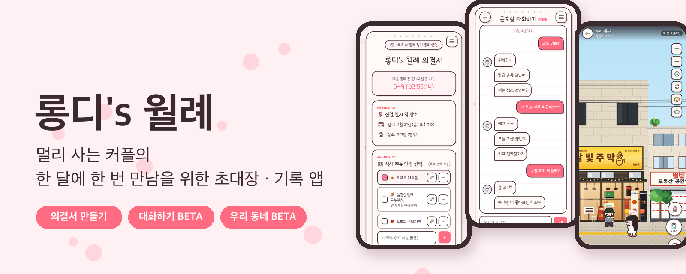
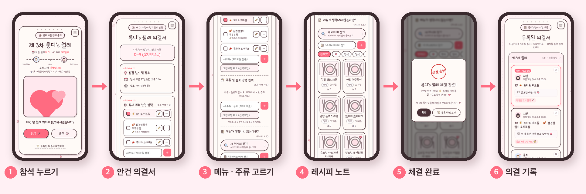
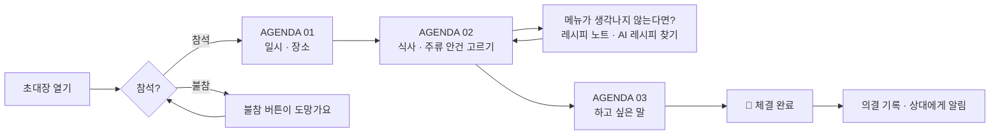
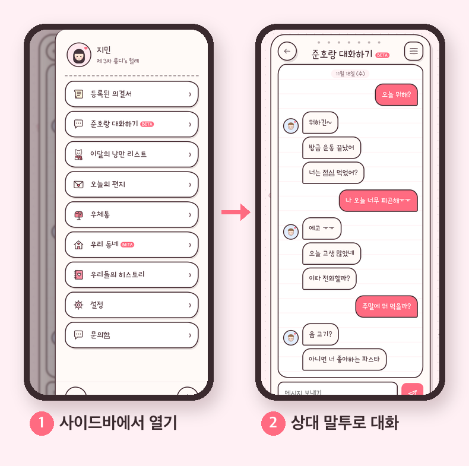
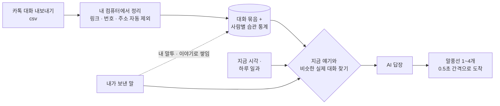
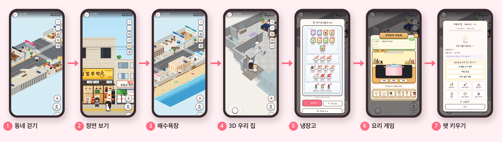
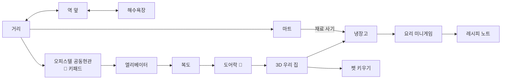
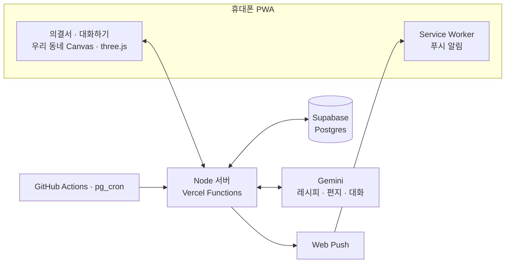

# 💌 롱디's 월례



> 멀리 떨어져 사는 커플은 한 달에 한 번 만나는 날을 정하려고 카톡을 한참 주고받아요.<br/>
> 언제 · 어디서 · 뭘 먹을지 대화가 쌓일수록 정한 내용을 다시 찾기 어려워져요.<br/>
> 그래서 만남을 **회의 안건처럼 의결**하고, 기다리는 동안 **대화하고 · 같이 놀 수 있는** 둘만의 앱을 만들었어요.

💌 **롱디's 월례**는 커플의 **"월례 정기 총회" 초대장 · 기록 앱**이에요. (PWA · 휴대폰 홈 화면에 설치)

- **의결서 만들기**: 참석 → 메뉴 · 주류 안건 고르기 → 체결. 정한 내용이 기록으로 남아요.
- **대화하기 (BETA)**: 둘이 나눈 카톡 말투를 배워서, 상대처럼 짧게 · 말풍선 여러 개로 대답해요.
- **우리 동네 (BETA)**: 동네와 우리 집을 픽셀 · 3D로 만들어 같이 걷고, 요리하고, 펫을 키워요.

<br/>

## ✨ Features

### 1. 📜 의결서 만들기





- 디데이 · 두 사람 사이 거리(km) · 처음 만난 날부터 며칠째인지 첫 화면에 보여요.
- 메뉴는 둘이 같이 추가하고, 메모도 달 수 있어요. 레시피 노트는 AI가 찾아준 레시피를 바로 저장해요.
- 체결하면 상대 폰으로 푸시 알림이 가고, 회차별 의결 기록이 쌓여요.

<br/>

### 2. 💬 대화하기 (BETA)





- 말끝 목록을 외우게 하지 않고 **실제 비율**을 알려줘요: 말풍선 길이, 한 번에 보내는 개수, 이모지 · ㅋㅋ · "~요" 비율.
- 메시지마다 보낸 시각을 같이 배워서 "지금 뭐해?"에 그 시간대에 보통 하는 일로 대답해요. 모르는 시각은 지어내지 않아요.
- 서로 여기서 한 말이 상대 쪽 AI에 쌓여서, 쓸수록 점점 그 사람처럼 말해요.

<br/>

### 3. 🏘️ 우리 동네 (BETA)





- 아이소메트릭 픽셀 동네를 걷고, 버튼 하나로 **정면 보기(3D)** 로 바꿔요. 집 안은 three.js 3D예요.
- 상대가 접속해 있으면 동네에서 실시간으로 만나요.
- 마트에서 산 재료로 레시피 노트의 요리를 미니게임으로 만들고, 같이 키우는 펫은 돌보지 않으면 알림이 와요.

<br/>

## 🛠️ Tech Stack & Architecture

       



- 프레임워크 없이 HTML · CSS · JS로 만들었어요. 그림은 손그림 SVG 아이콘과 캔버스 픽셀 아트예요.
- 서버는 하나의 Node 핸들러로 Vercel에서 돌아가요. Supabase 설정이 없으면 `data/` 폴더 파일로 저장해서 바로 로컬에서 돌려볼 수 있어요.

<br/>

## 🚀 Run locally

```bash
npm install
cp .env.example .env   # 비워둬도 로컬 파일 저장소로 실행돼요 (AI · 푸시 기능만 꺼짐)
npm start              # http://localhost:5500
```

<br/>

> 이 저장소는 포트폴리오용 공개본이에요. 이름 · 사진 · 장소 · 대화 · 위치는 모두 **예시 데이터**로 바꿨고, 실제 서비스 주소와 키는 들어 있지 않아요.
